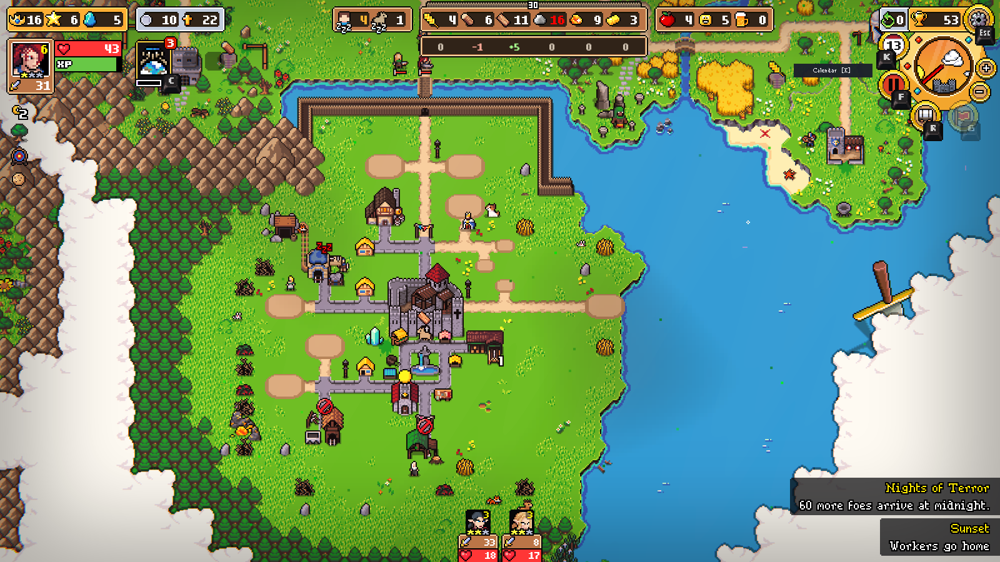
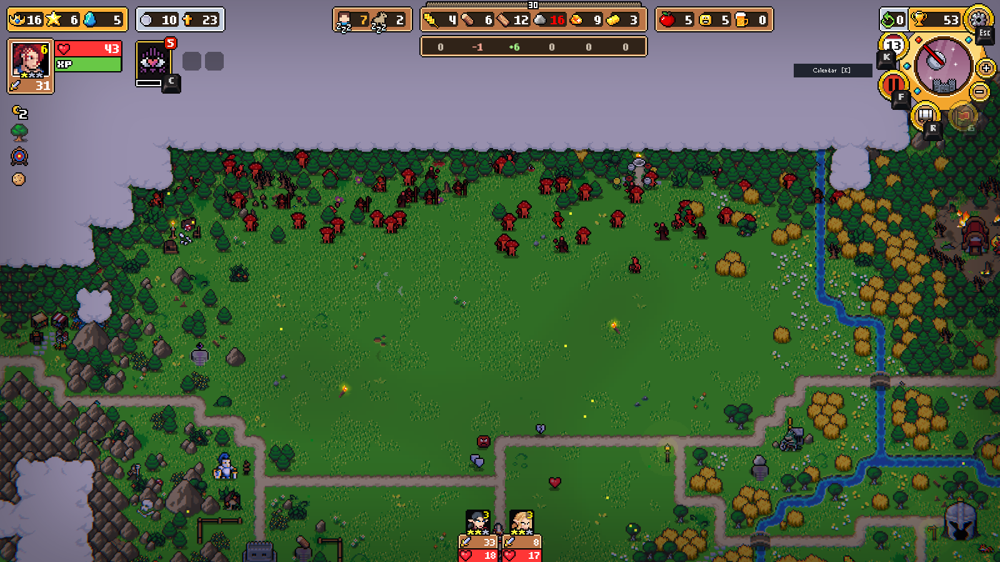

# Nights of Terror

Hold the kingdom through a second wave. On ordinary nights, a dusk warning announces how many enemies will arrive at midnight.

## Features

- Midnight reinforcements number **50% of the ordinary wave's original spawn quota**, rounded up. The ordinary wave size varies by day, Curse and other game modifiers. Clearing the first group early doesn’t affect the reinforcement count.
- Reinforcements are drawn from the enemy pool selected by dusk, with higher odds for recent tiers. Each enemy has full normal HP for its type, level, evolution and curse.
- Reinforcements arrive at Rush spacing by default. The normal Rush unlocks, controls, Auto Rush preference and bonus Glory follow the base game.
- Reinforcement kills count toward the tavern's ordinary kill rewards and Glory. Clear both groups and collect any required chest to open the tavern.
- The normal encounters apply on boss nights, day 29 and the final day of a shortened challenge.

## How to Use

1. Play an ordinary day and watch for the **Nights of Terror** warning at dusk. It shows the number of incoming reinforcements.
2. Keep defending when the **Midnight** alert appears. If the ordinary wave is still alive, both groups can fight at once.
3. Open the tavern after both groups are cleared and any required chest is collected. Your usual tavern controls or automatic entry setting apply.
4. For slower arrivals, set `RushedArrival = false` under `[Reinforcements]` in `BepInEx/config/gkj.nightsofterror.cfg`. Each arrival is then one game second apart.

## Screenshots

**Dusk warning at 1×**

*The dusk warning shows how many reinforcements will arrive.*

**Full midnight group at 1×**

*Midnight reinforcements draw from the same enemy pool as the original wave.*

## Compatibility

- Works with Super Fantasy Kingdom **0.8.068** and the other [GKJ mods](https://thunderstore.io/c/super-fantasy-kingdom/p/GKJ/).
- [Hold the Line](https://thunderstore.io/c/super-fantasy-kingdom/p/GKJ/HoldTheLine/) settles the wager after the night is cleared, including both waves. A wall hit can forfeit the stake during either wave.
- [Cursed Relics](https://thunderstore.io/c/super-fantasy-kingdom/p/GKJ/CursedRelics/) and [Cursed Equipment](https://thunderstore.io/c/super-fantasy-kingdom/p/GKJ/CursedEquipment/) can be used alongside the extra wave. Reinforcements grant the game’s usual rewards for their enemies.
- Boss nights, Day 29, and the final day of shortened challenges use their usual encounters. Replaying a dawn schedules that day’s wave again.
- These community mods can share the same profile. [Achievement Enabler](https://thunderstore.io/c/super-fantasy-kingdom/p/ownlyme/AchievementEnabler/), [Bakery Uses Wheat](https://thunderstore.io/c/super-fantasy-kingdom/p/ownlyme/BakeryUsesWheat/), [More Relics](https://thunderstore.io/c/super-fantasy-kingdom/p/ownlyme/MoreRelics/), [Right Click Skip](https://thunderstore.io/c/super-fantasy-kingdom/p/ownlyme/RightClickSkip/), and [Tavern Food Priorities](https://thunderstore.io/c/super-fantasy-kingdom/p/ownlyme/TavernFoodPriorities/).

## Installation

1. In Thunderstore Mod Manager or r2modman, select your **Super Fantasy Kingdom** profile.
2. Install **NightsOfTerror** by **GKJ**. Allow the manager to install [BepInExPack](https://thunderstore.io/c/super-fantasy-kingdom/p/BepInEx/BepInExPack/) and [HideManagerGameObject Config](https://thunderstore.io/c/super-fantasy-kingdom/p/BepInEx/HideManagerGameObject_Config/).
3. Start the game modded and watch for the warning on an ordinary day.

## Support

[Support GKJ Games on Ko-fi](https://ko-fi.com/gkj_games)
