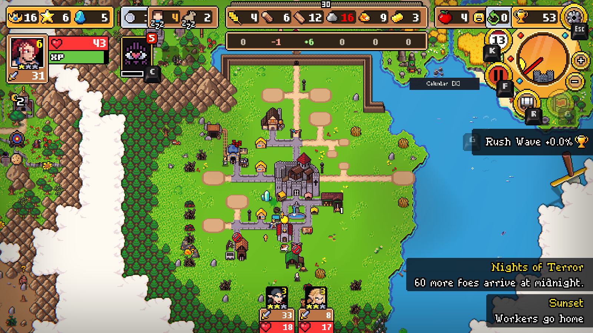
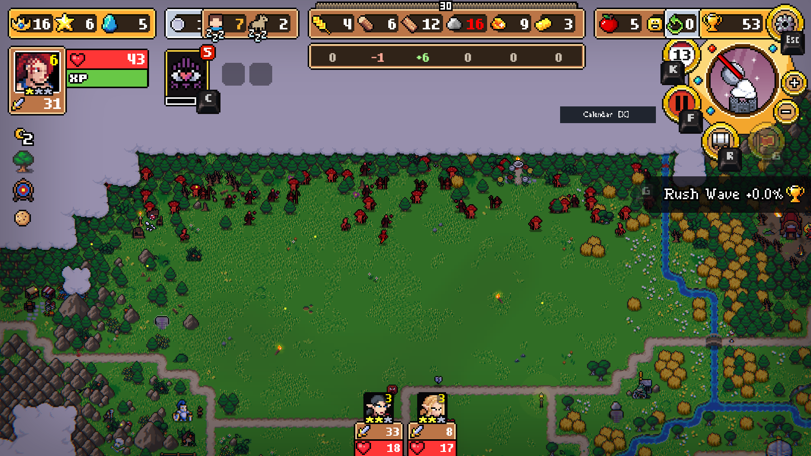

# Nights of Terror

Hold the kingdom through a second wave. On ordinary nights, a dusk warning announces how many enemies will arrive at midnight.

## Features

- Midnight reinforcements number **50% of the ordinary wave's original spawn quota**, rounded up. The ordinary wave size varies by day, Curse and other game modifiers. Clearing the first group early doesn’t affect the reinforcement count.
- Reinforcements are drawn from the enemy pool selected by dusk, with higher odds for recent tiers. Each enemy has full normal HP for its type, level, evolution and curse.
- Reinforcements arrive at Rush spacing by default. The normal Rush unlocks, controls, Auto Rush preference and bonus Glory follow the base game.
- Reinforcement kills count toward the tavern's ordinary kill rewards and Glory. Clear both groups and collect any required chest to open the tavern.
- The normal encounters apply on boss nights, day 29 and the final day of a shortened challenge.

## How to Use

1. Play an ordinary day and watch for the **Nights of Terror** warning at dusk. It shows the number of incoming reinforcements.
2. Keep defending when the **Midnight** alert appears. If the ordinary wave is still alive, both groups can fight at once.
3. Open the tavern after both groups are cleared and any required chest is collected. Your usual tavern controls or automatic entry setting apply.
4. For slower arrivals, set `RushedArrival = false` under `[Reinforcements]` in `BepInEx/config/gkj.nightsofterror.cfg`. Each arrival is then one game second apart.

## Screenshots

**Dusk warning at 1.5×**

*Day 13 of the playtest. The warning shows the count for that night.*

**Full midnight group at 1.5×**

*The complete midnight group in this playtest drew six enemy types from the dusk pool.*

## Compatibility

- Tested on Super Fantasy Kingdom **0.8.068**. The 0.1.3 screenshots and settlement check used a copied Human day-13 save at normal game speed and 1.5× UI. The test driver controlled enemy clearance. The larger wave's natural combat balance remains untested. [Playtest notes](https://github.com/GKJ-Super-Fantasy-Kingdom/nights-of-terror/blob/v0.1.3/docs/playtest-0.1.3.md)
- With [Hold the Line](https://thunderstore.io/c/super-fantasy-kingdom/p/GKJ/HoldTheLine/) 0.2.3, the wager stays active through both groups and settles once after combat. Hold the Line is optional.
- The mod adds no save fields. Replaying a dawn schedules that day's encounter again.

## Installation

1. In Thunderstore Mod Manager or r2modman, select your **Super Fantasy Kingdom** profile.
2. Install **NightsOfTerror** by **GKJ**. Allow the manager to install [BepInExPack](https://thunderstore.io/c/super-fantasy-kingdom/p/BepInEx/BepInExPack/) and [HideManagerGameObject Config](https://thunderstore.io/c/super-fantasy-kingdom/p/BepInEx/HideManagerGameObject_Config/).
3. Start the game modded and watch for the warning on an ordinary day.

See the [contribution guide](https://github.com/GKJ-Super-Fantasy-Kingdom/nights-of-terror/blob/main/CONTRIBUTING.md) for local builds, testing and issue reports. The original mod code is released under the [MIT License](https://github.com/GKJ-Super-Fantasy-Kingdom/nights-of-terror/blob/main/LICENSE). Super Fantasy Kingdom and its assets retain their respective ownership.
